# TP SSH : Mise en place du protocole SSH

> **Cours :** Services Réseaux Avancés — L3 GLSI, DGI / ESP — Année académique 2026-2027  
> **Enseignant :** Dr GUEYE  
> **Binôme :** Abdoul Aziz Diop & Aïssata Mbaye  
> **TP n° 1**

---

## Sommaire

1. [Objectifs du TP](#1-objectifs-du-tp)
2. [Rappel théorique sur SSH](#2-rappel-théorique-sur-ssh)
3. [Environnement de travail](#3-environnement-de-travail)
4. [Étape 1 — Installation du serveur SSH](#étape-1--installation-du-serveur-ssh)
5. [Étape 2 — Connexion SSH depuis le client](#étape-2--connexion-ssh-depuis-le-client)
6. [Étape 3 — Configuration des clés SSH](#étape-3--configuration-des-clés-ssh)
7. [Étape 4 — Tunnel SSH en ligne de commande](#étape-4--tunnel-ssh-en-ligne-de-commande)
8. [Problèmes rencontrés et solutions](#problèmes-rencontrés-et-solutions)
9. [Observations de sécurité](#observations-de-sécurité)
10. [Conclusion](#conclusion)

---

## 1. Objectifs du TP

Ce TP met en œuvre le protocole **SSH (Secure Shell)** dans un environnement hétérogène
Windows / Linux. Il s'agit de :

- installer et activer un **serveur OpenSSH** sur une machine Ubuntu ;
- vérifier que le service écoute bien sur le port **22** ;
- établir une connexion à distance depuis un **client Windows** ;
- mettre en place une **authentification par clés** en remplacement du mot de passe ;
- créer un **tunnel SSH** pour acheminer un autre protocole à travers la connexion chiffrée ;
- dégager les bonnes pratiques de sécurisation d'un service SSH.

---

## 2. Rappel théorique sur SSH

**SSH** est un protocole qui permet d'ouvrir une session distante sur une machine et d'y
exécuter des commandes, à travers un canal entièrement chiffré. Il remplace les protocoles
historiques *Telnet*, *rlogin* et *FTP*, qui transmettaient identifiants et données en clair.

| Caractéristique | Valeur |
|---|---|
| Port par défaut | **TCP 22** |
| Couche OSI | Application (7) |
| Modèle | Client / serveur |
| Implémentation de référence | **OpenSSH** (`sshd` côté serveur, `ssh` côté client) |
| Fichier de configuration serveur | `/etc/ssh/sshd_config` |

**Les trois services rendus par SSH :**

1. **Confidentialité** — tout le trafic est chiffré après négociation d'une clé de session.
2. **Authentification** — du serveur (par sa clé d'hôte) *et* du client (mot de passe ou clé
   publique).
3. **Intégrité** — toute altération des données en transit est détectée.

**Au-delà du terminal.** SSH sert aussi de transport pour d'autres usages : copie de fichiers
(`scp`, `sftp`), redirection de ports (tunnels), redirection graphique X11, ou encore
l'accès aux dépôts Git. C'est cette capacité de transport qui est exploitée à l'étape 4.

---

## 3. Environnement de travail

| Rôle | Système | Adresse IP | Outil utilisé |
|---|---|---|---|
| **Serveur SSH** | Ubuntu 24.04.3 LTS | `192.168.1.80` | `openssh-server` (`sshd`) |
| **Client** | Windows | `192.168.1.9` | client OpenSSH intégré (PowerShell / invite de commandes) |

- **Réseau :** les deux machines sont sur le même réseau local `192.168.1.0/24`.
- **Compte de test :** utilisateur `aicha`, créé au préalable sur le serveur distant.
- **Remarque :** depuis Windows 10, le client OpenSSH est installé nativement ; les commandes
  `ssh`, `scp` et `ssh-keygen` sont donc disponibles sans logiciel tiers comme PuTTY.

---

## Étape 1 — Installation du serveur SSH

### 1.1 Installation et activation du service

```bash
sudo apt update
sudo apt install openssh-server
sudo systemctl enable ssh
sudo systemctl start ssh
```

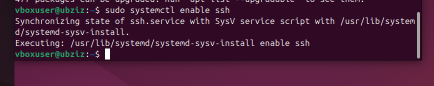

`apt update` actualise la liste des paquets disponibles et `apt install openssh-server`
installe le serveur SSH. `enable` active son lancement automatique au démarrage, tandis que
`start` le démarre immédiatement.

> La distinction entre les deux est importante : `start` ne vaut que pour la session en cours,
> `enable` crée le lien symbolique qui fera démarrer le service à chaque amorçage du système.

### 1.2 Vérification du statut du service

```bash
sudo systemctl status ssh
```

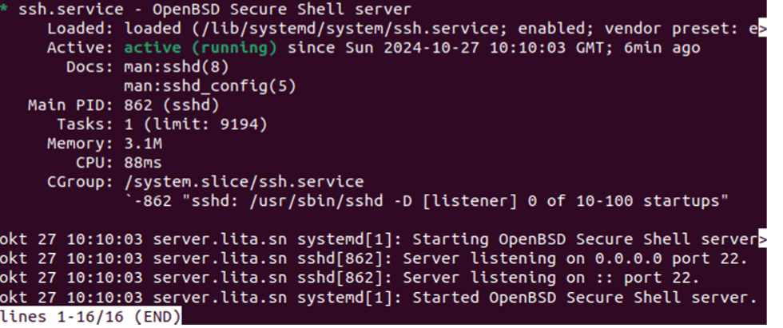

Le statut **active (running)** et **enabled** confirme que le service tourne et démarrera à
chaque *boot*. Les lignes « *Server listening on 0.0.0.0 port 22* » et « *:: port 22* »
montrent qu'il écoute sur toutes les interfaces, en IPv4 et en IPv6.

### 1.3 Vérification de l'ouverture du port 22

```bash
netstat -anp | grep -w 22
```

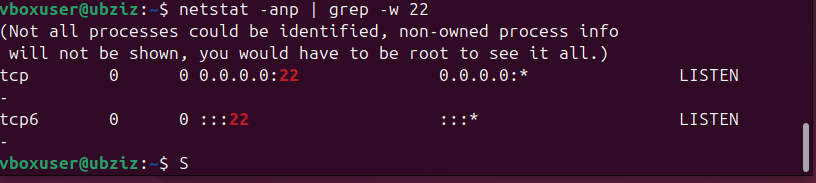

L'état **LISTEN** prouve que le serveur SSH écoute sur le port 22, en `tcp` comme en `tcp6`.
L'accessibilité depuis le réseau dépend en plus du pare-feu, que l'on contrôle avec :

```bash
sudo ufw status
sudo ufw allow 22/tcp     # ou : sudo ufw allow OpenSSH
```

> `netstat` étant en voie de remplacement, l'équivalent moderne est
> `ss -tlnp | grep :22`.

---

## Étape 2 — Connexion SSH depuis le client

La syntaxe générale de connexion est :

```bash
ssh utilisateur@adresse_ip_du_serveur
```

où `utilisateur` est le compte **cible sur le serveur** et non celui du poste client. Dans
notre cas :

```powershell
ssh aicha@192.168.1.80
```

### 2.1 Validation de l'empreinte du serveur

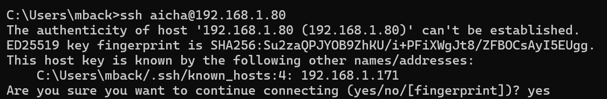

À la première connexion, SSH demande de valider l'empreinte de la clé du serveur pour éviter
une attaque de **l'homme du milieu**. En répondant « yes », cette clé est enregistrée dans le
fichier `known_hosts` et sera vérifiée automatiquement aux connexions suivantes.

Le message précise ici que la même clé d'hôte est déjà connue sous une autre adresse
(`192.168.1.171`) : c'est normal lorsque le serveur a changé d'adresse IP, par exemple après
un nouveau bail DHCP, car l'empreinte est liée à la machine et non à son adresse.

> Si, à l'inverse, l'empreinte **change** pour une adresse déjà connue, SSH affiche un
> avertissement en gros caractères et refuse la connexion. Il ne faut jamais supprimer la
> ligne concernée de `known_hosts` sans avoir d'abord vérifié la cause du changement.

### 2.2 Session établie

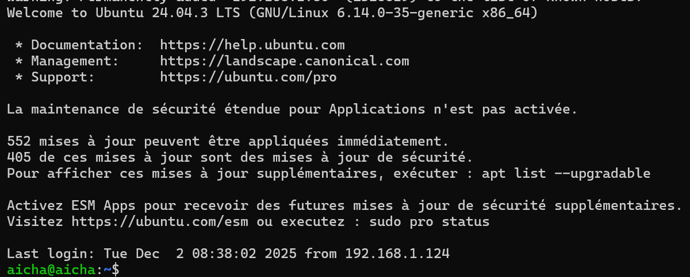

La bannière d'accueil d'Ubuntu 24.04.3 LTS s'affiche et l'invite devient `aicha@...:~$` :
le terminal pilote désormais la machine distante. La ligne *Last login* indique la date et
l'adresse de la connexion précédente, information utile pour repérer un accès non autorisé.

---

## Étape 3 — Configuration des clés SSH

L'authentification par mot de passe est vulnérable aux attaques par force brute.
L'authentification **par clés** repose sur une paire asymétrique : la **clé privée** reste
secrète sur le client, la **clé publique** est déposée sur le serveur. Le serveur envoie un
défi que seul le détenteur de la clé privée peut résoudre — le secret ne circule jamais sur
le réseau.

### 3.1 Génération de la paire de clés

```powershell
ssh-keygen
```

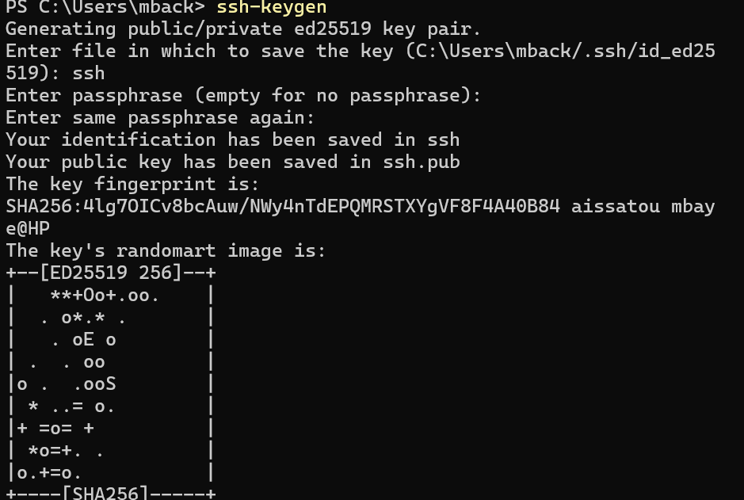

`ssh-keygen` génère une paire de clés : la clé privée reste secrète sur le client et la clé
publique est déposée sur le serveur. Ici l'algorithme est **ED25519** (choix par défaut), plus
moderne et plus court que RSA à sécurité équivalente, et la **passphrase vide** permet une
connexion sans saisie mais expose la clé en cas de vol du poste.

Le *randomart* affiché est une représentation graphique de l'empreinte : il permet à l'œil
humain de comparer rapidement deux clés, sans lire la chaîne SHA256 caractère par caractère.

### 3.2 Vérification de la présence du dossier `.ssh`

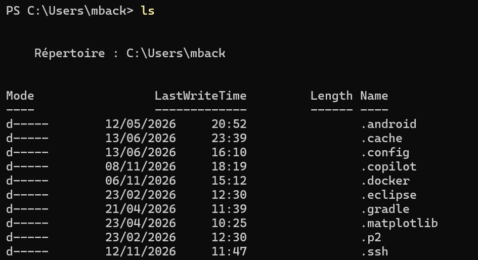

### 3.3 Contenu du dossier `.ssh`

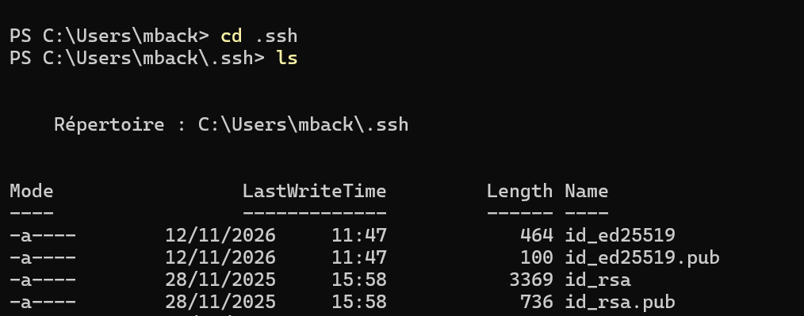

Le dossier contient la clé privée `id_ed25519` et sa clé publique `id_ed25519.pub`.
La différence de taille est caractéristique : environ 460 octets pour la clé privée contre
une centaine pour la clé publique, qui tient sur une seule ligne.

**Seul le fichier `.pub` doit quitter le poste client.** La clé privée ne se copie jamais sur
un serveur.

### 3.4 Copie de la clé publique vers le serveur

```powershell
scp $env:USERPROFILE\.ssh\id_ed25519.pub aicha@192.168.1.80:~
```

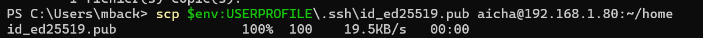

La clé publique est envoyée au serveur, mais elle ne sert qu'une fois **ajoutée au fichier
`~/.ssh/authorized_keys`** du serveur. Côté serveur, il reste donc à exécuter :

```bash
mkdir -p ~/.ssh
cat ~/id_ed25519.pub >> ~/.ssh/authorized_keys
chmod 700 ~/.ssh
chmod 600 ~/.ssh/authorized_keys
```

Les **permissions sont impératives** : `sshd` refuse purement et simplement d'utiliser un
fichier `authorized_keys` accessible en écriture par d'autres utilisateurs, et l'échec est
silencieux côté client, qui retombe sur l'authentification par mot de passe. Dès que ces
étapes sont faites, la connexion se fait sans mot de passe.

> Sous Linux, l'ensemble de l'opération tient en une commande : `ssh-copy-id aicha@192.168.1.80`.
> Cet utilitaire n'est pas fourni avec le client OpenSSH de Windows, d'où le passage par `scp`.

---

## Étape 4 — Tunnel SSH en ligne de commande

Le principe repose sur la mise en place d'un **tunnel sécurisé** utilisant le protocole SSH
entre un client et un serveur, afin de permettre le transport d'autres protocoles tels que
FTP, HTTP ou MySQL. En d'autres termes, il s'agit d'acheminer différents types de données à
travers un port autorisé.

### 4.1 Ouverture du tunnel

```powershell
ssh -L 1024:127.0.0.1:80 aicha@192.168.1.80
```

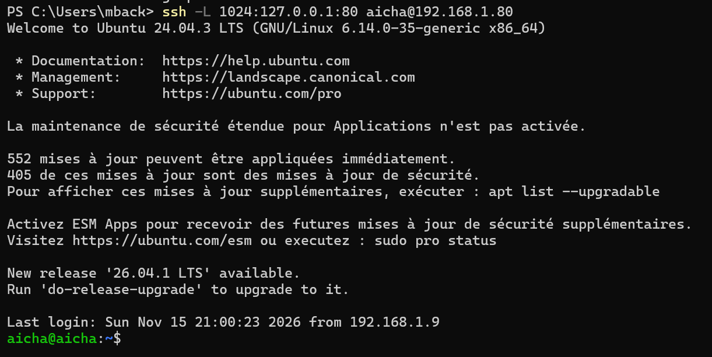

> **NB :** le compte utilisateur `aicha` a préalablement été créé sur le serveur distant.

L'option `-L 1024:127.0.0.1:80` redirige le **port local 1024** vers le **port 80 du
serveur**, où `127.0.0.1` désigne le serveur lui-même. Tout le trafic passe dans la connexion
SSH chiffrée.

La syntaxe se lit de gauche à droite :

```
-L  <port local> : <hôte vu depuis le serveur> : <port distant>
     1024          127.0.0.1                     80
```

L'hôte du milieu est résolu **depuis le serveur**. Mettre `127.0.0.1` vise donc le serveur
lui-même ; on pourrait tout aussi bien y mettre l'adresse d'une troisième machine accessible
seulement depuis le serveur — c'est précisément l'intérêt du procédé, qui permet de rebondir
vers un réseau autrement inaccessible.

> La redirection inverse existe également : `-R` expose un port du poste client sur le
> serveur, et `-D` crée un proxy SOCKS dynamique.

### 4.2 Accès au service à travers le tunnel

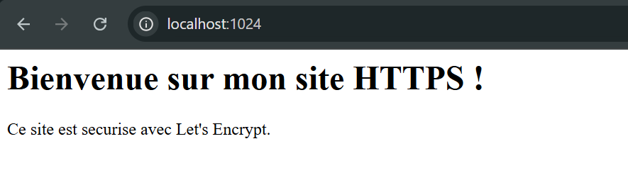

Le site est atteint via `localhost:1024` : le navigateur du client croit dialoguer avec une
ressource locale, alors que la requête traverse le tunnel jusqu'au serveur web distant.

**Point important :** le chiffrement est assuré par **le tunnel SSH et non par TLS**. Le
message « Ce site est sécurisé avec Let's Encrypt » affiché sur la page n'est donc pas ce qui
sécurise cet accès — c'est un simple contenu HTML, et l'URL reste d'ailleurs en `http://`.
Ce contre-exemple illustre bien qu'il ne faut pas confondre ce qu'une page *affiche* et ce qui
protège réellement la communication.

---

## Problèmes rencontrés et solutions

| Problème | Cause | Solution appliquée |
|---|---|---|
| `Connection refused` | Service `sshd` arrêté | `sudo systemctl start ssh` puis vérification par `status` |
| `Connection timed out` | Port 22 bloqué par le pare-feu | `sudo ufw allow 22/tcp` |
| Avertissement d'empreinte inconnue | Première connexion à cet hôte | Validation de l'empreinte, enregistrée dans `known_hosts` |
| Mot de passe toujours demandé malgré la clé | Clé publique non ajoutée à `authorized_keys`, ou permissions trop larges | `chmod 700 ~/.ssh` et `chmod 600 ~/.ssh/authorized_keys` |
| `ssh-copy-id` introuvable sous Windows | Utilitaire absent du client OpenSSH de Windows | Transfert par `scp` puis ajout manuel à `authorized_keys` |
| Port local déjà utilisé lors de l'ouverture du tunnel | Un autre service occupe le port choisi | Choisir un port libre supérieur à 1024 |

---

## Observations de sécurité

SSH est un service directement exposé aux attaques automatisées : un port 22 ouvert sur
Internet reçoit des tentatives de connexion en continu. Les bonnes pratiques suivantes
s'imposent :

- **Désactiver l'authentification par mot de passe** une fois les clés en place, dans
  `/etc/ssh/sshd_config` :
  ```
  PasswordAuthentication no
  PubkeyAuthentication yes
  ```
  *À ne faire qu'après avoir vérifié que la connexion par clé fonctionne, sous peine de se
  verrouiller hors du serveur.*
- **Interdire la connexion directe en root** : `PermitRootLogin no`, puis utiliser `sudo`.
- **Protéger la clé privée par une passphrase**, et utiliser un agent (`ssh-agent`) pour
  éviter de la saisir à chaque connexion. La passphrase vide utilisée dans ce TP ne se
  justifie qu'en environnement de laboratoire.
- **Changer le port d'écoute** : réduit fortement le bruit des scans automatisés, sans
  constituer une protection à part entière.
- **Installer `fail2ban`** pour bannir automatiquement les adresses enchaînant les échecs
  d'authentification.
- **Restreindre les comptes autorisés** avec les directives `AllowUsers` ou `AllowGroups`.
- **Filtrer les adresses sources** au niveau du pare-feu lorsque c'est possible.
- **Surveiller les journaux** (`/var/log/auth.log`) et la ligne *Last login* à chaque
  connexion.
- **Vérifier systématiquement l'empreinte** présentée à la première connexion, par un canal
  indépendant : c'est le seul moment où une attaque de l'homme du milieu peut passer
  inaperçue.

---

## Conclusion

Ce TP a permis de déployer un serveur **OpenSSH** sur Ubuntu, d'y accéder depuis un client
Windows, de remplacer l'authentification par mot de passe par une **authentification par clés
ED25519**, puis d'exploiter la connexion SSH comme **canal de transport** pour un service web
au moyen d'une redirection de port.

Au-delà de la manipulation, les étapes ont mis en évidence les mécanismes de confiance du
protocole : la vérification de l'empreinte de l'hôte, qui protège contre l'usurpation de
serveur, et la cryptographie asymétrique, qui évite de faire circuler un secret sur le réseau.
L'exemple du tunnel rappelle enfin une distinction essentielle : la sécurité d'une
communication tient au canal réellement utilisé, et non à ce qu'une page affiche.

---

## Arborescence du dépôt

```
.
├── README.md
└── captures/
    ├── 01-installation-ssh/
    ├── 02-connexion-client/
    ├── 03-cles-ssh/
    └── 04-tunnel-ssh/
```
